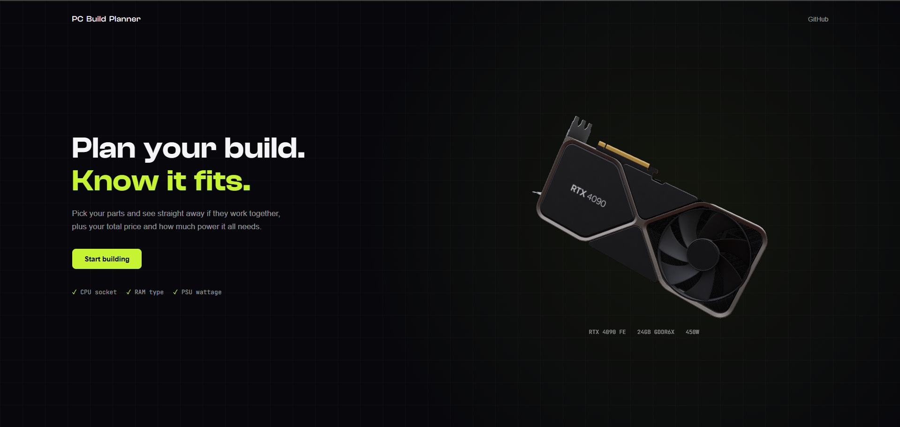

# PC Build Planner

A full stack web app for planning a PC build. Pick your parts and see straight away if they work together, plus your total price and how much power the build needs. Make an account to save your builds and come back to them later.

**Live demo:** [pcbuildplanner.vercel.app](https://pcbuildplanner.vercel.app)



## Features

- 3D RTX 4090 model on the welcome page that you can drag around
- Pick a CPU, motherboard, RAM, GPU and power supply from a slide-in part picker
- Compatibility checks:
  - CPU socket has to match the motherboard
  - RAM type (DDR4 / DDR5) has to match the motherboard
  - PSU wattage has to cover the CPU + GPU + 100W headroom
- Parts that don't fit are greyed out with the reason
- Live total price and power usage bar, with a warning when the PSU is above 80% load
- Sign up and log in to save your builds
- My Builds page to open or delete your saved builds
- You can build without an account, and your parts are kept if you log in halfway

## Tech Stack

**Front end**
- React (Vite)
- React Three Fiber + Drei (3D model)
- CSS
- Deployed on Vercel

**Back end**
- Node.js + Express (REST API)
- MongoDB Atlas + Mongoose
- bcrypt for hashing passwords
- JWT for login tokens
- Deployed on Render

## How it works

```
React (Vercel)  -->  Express API (Render)  -->  MongoDB Atlas
```

The React app never talks to the database directly. Every request goes through the Express API, which checks the login token and makes sure you can only see and change your own builds.

## API

| Method | Route | What it does | Login needed |
|---|---|---|---|
| POST | `/api/auth/register` | Make an account | No |
| POST | `/api/auth/login` | Log in and get a token | No |
| GET | `/api/builds` | Get your saved builds | Yes |
| GET | `/api/builds/:id` | Get one of your builds | Yes |
| POST | `/api/builds` | Save a new build | Yes |
| PUT | `/api/builds/:id` | Update one of your builds | Yes |
| DELETE | `/api/builds/:id` | Delete one of your builds | Yes |

## Security

- Passwords are hashed with bcrypt and never stored as plain text
- Login uses JWT tokens that expire after 7 days
- Every build is linked to a user, and the API only returns builds that belong to whoever is logged in
- Login errors don't say whether the username or the password was wrong
- Secrets (database link, JWT secret) are kept in environment variables and never pushed to GitHub

## Run it locally

**1. Back end**

```
cd server
npm install
```

Make a `server/.env` file:

```
MONGO_URI=your-mongodb-connection-string
JWT_SECRET=any-long-random-string
PORT=5000
```

Then start it:

```
npm start
```

**2. Front end** (in a second terminal, from the main folder)

```
npm install
npm run dev
```

The front end uses `http://localhost:5000` by default. When deployed, it uses the `VITE_API_URL` environment variable instead.

## Project structure

```
pc-build-planner/
├── src/                 React front end
│   ├── components/      Welcome, Builder, Part Picker, My Builds, Login screens
│   ├── data/parts.js    All the parts and prices
│   ├── utils/           Compatibility checks
│   └── api.js           Backend URL
└── server/              Express back end
    ├── models/          User and Build
    ├── routes/          auth.js and builds.js
    ├── middleware/      Login check
    └── index.js         Starts the server
```

## Coming next

- Tests for the compatibility checks (Jest)
- Run tests automatically on every push (GitHub Actions)
- Share a build with a link

## Credits

3D model: ["GeForce RTX 4090 Founders Edition"](https://sketchfab.com/3d-models/geforce-rtx-4090-founders-edition-d417c0b4c3bd475eb9669afcd14a2601) by Alexander Ershov (exéla) on Sketchfab, licensed under [CC BY-NC 4.0](https://creativecommons.org/licenses/by-nc/4.0/). The model was rotated and scaled for this project.

Part prices are rough SGD estimates and only for demo purposes.

## Author

Angelo, Year 2 IT student at Republic Polytechnic
GitHub: [Aangelo555](https://github.com/Aangelo555)
